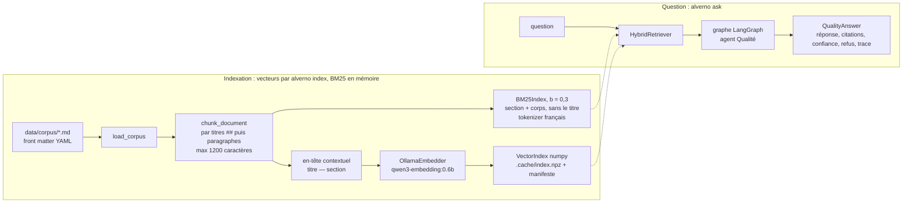
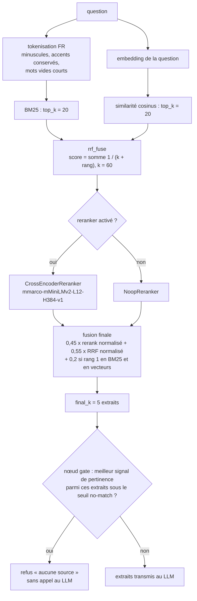
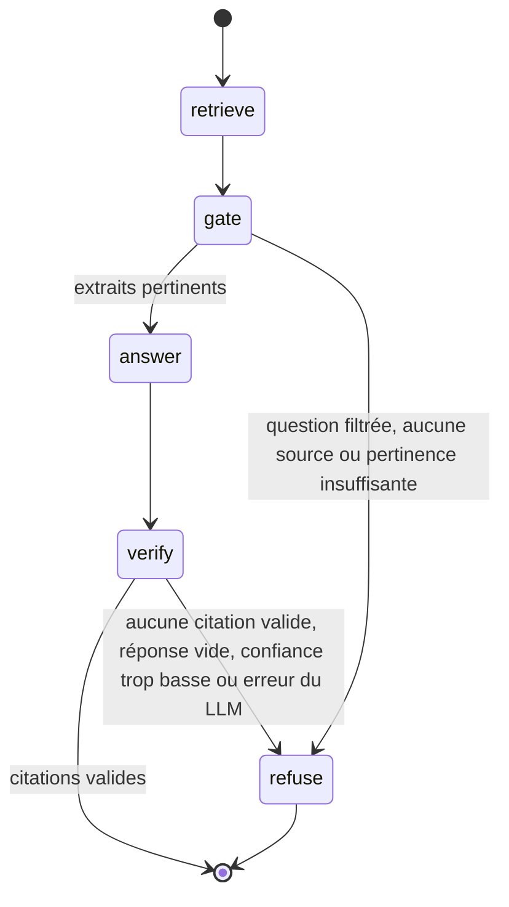
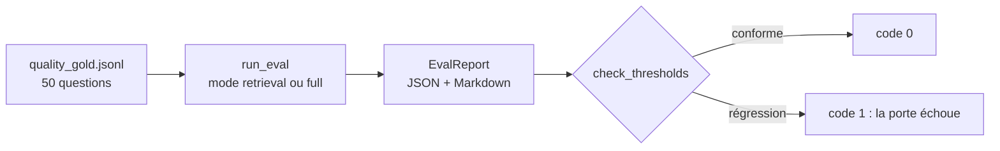
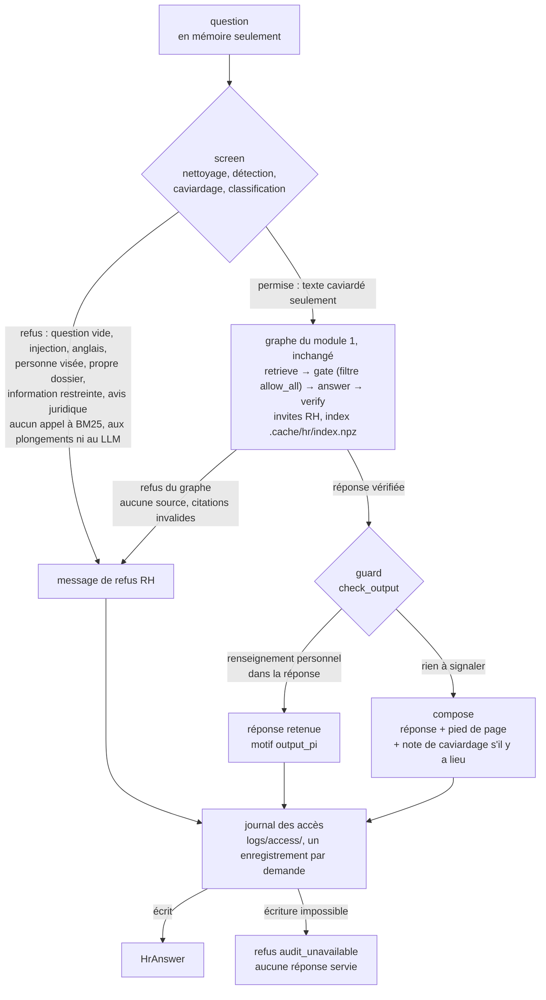

# Architecture — agent Qualité (jalon 1) et assistant RH (jalon 2)

> Entreprise et données entièrement fictives.

Ce document décrit le pipeline de recherche hybride et le graphe LangGraph de l'agent Qualité, puis la couche Loi 25 et l'enveloppe de l'assistant RH ([module 2](#module-2--couche-loi-25-et-assistant-rh)). Les identifiants de code sont en anglais ; les réponses à l'utilisateur sont en français.

## Vue d'ensemble



## Pipeline de recherche hybride



Points clés :

- **Deux signaux complémentaires.** BM25 capte les termes exacts (numéros de documents, nuances d'inox, « caniveau », « W59 ») ; les vecteurs captent les reformulations (« trou au bord de la soudure » pour « caniveau »).
- **RRF** fusionne des rangs plutôt que des scores, ce qui évite de calibrer deux échelles incomparables. La fonction `rrf_fuse` est pure et testée unitairement.
- **Reranker optionnel** (extra `rerank`) : un *cross-encoder* multilingue relit chaque paire question-extrait. Une fois l'extra installé, le réglage par défaut `reranker = auto` l'active. Sans l'extra, ou avec `reranker = none`, `NoopReranker` garde l'ordre RRF et le pipeline reste entièrement fonctionnel.
- **Bonus de consensus** : un extrait classé premier par les deux méthodes reçoit un bonus, signe fort de pertinence.
- **Barrière no-match** : la recherche renvoie les `final_k` meilleurs extraits même s'ils sont peu pertinents ; si même le plus fort signal de pertinence parmi eux est sous le seuil, le nœud `gate` refuse (« aucune source ») sans appeler le LLM. Le signal dépend du reranker en usage, car les scores RRF reposent sur des rangs et ne disent rien de la pertinence absolue :
  - avec le *cross-encoder* : meilleur score de reranking parmi les extraits retenus, seuil `no_match_threshold` (0,0, non calibré) ;
  - avec Ollama sans reranker : meilleure similarité cosinus parmi les extraits retenus, seuil `vector_no_match_threshold` (0,55) ;
  - en mode `--fake` : meilleure couverture lexicale de la question parmi les extraits retenus, seuil `fake_no_match_threshold` (0,5).
  Mesuré avec `qwen3-embedding:0.6b` : le seuil de 0,55 refuse les pièges les plus éloignés sans refuser aucune question répondable (minimum 0,569), mais les pièges « information absente » (0,48 à 0,62) chevauchent les vraies questions ([ADR 0004](adr/0004-calibrate-ollama-gate.md)) ; avec `gemma4:e4b` et `ministral-3:8b`, le LLM et la vérification des citations refusent ceux qui passent la barrière, mais `llama3.2:3b` en laisse passer deux.
- **BM25 sans le titre** : le titre est répété dans chaque extrait d'un document. Indexé par BM25, il donnait un score à tous les extraits du document nommé dans la question, et la normalisation de longueur favorisait les plus courts, au point d'écarter du contexte l'extrait qui contenait la réponse. BM25 indexe donc la section et le corps (`Chunk.lexical_text`, b = 0,3) ; les vecteurs et le reranker gardent l'en-tête complet (`Chunk.indexed_text`).
- **Versions périmées** : un document est marqué périmé par son front matter (`superseded_by`, ou un `status` tel que `superseded`, `obsolete`, `archived`, `remplacé` ou `périmé`) ou quand son identifiant est `<BASE>-V<n>` et que `<BASE>` existe avec une date plus récente (ex. `QP-006-V2` remplacé par `QP-006`). Ses extraits perdent 0,5 au score final, ou seulement 0,1 quand la question nomme cette version (« version 2.1 », « v2.1 ») ou son identifiant, pour que les questions d'historique la retrouvent ; ils portent la mention « VERSION PÉRIMÉE » dans le prompt, pour que la version en vigueur l'emporte.
- **Sensibilité** : `load_corpus` rejette tout document dont `sensitivity` dépasse `max_sensitivity` (2 pour le module Qualité, voir [loi25.md](loi25.md)).
- **Intégrité de l'index** : le manifeste de `.cache/index.npz` enregistre le modèle d'embeddings et l'empreinte du corpus. Un index qui ne correspond pas est refusé ; il faut relancer `alverno index`.

Paramètres principaux (`Settings`, préfixe `ALVERNO_`) : `top_k` (20 candidats), `final_k` (5 extraits retenus), `rrf_k` (60), `no_match_threshold`, `vector_no_match_threshold`, `fake_no_match_threshold`, `min_confidence` (0,2), `reranker` (`auto`, `cross-encoder` ou `none`), `rerank_model`, `embed_model`, `chat_model`, `ollama_url`, `request_timeout`, `keep_alive`, `num_ctx` (8 192, modèle de clavardage), `embed_num_ctx` (2 048, modèle de plongements). La liste complète est dans `src/alverno_lab/config.py`.

## Graphe LangGraph de l'agent Qualité



État partagé (`TypedDict` `QualityState`) : `question`, `hits`, `decision`, `refusal_reason`, `relevance`, `answer`, `citations`, `dropped_citations`, `ungrounded_numbers`, `confidence`, `refused`, `trace`.

| Nœud | Rôle | Appelle le LLM ? |
|---|---|---|
| `retrieve` | exécute `HybridRetriever.search` et remplit `hits` | non |
| `gate` | filtre d'abord la question (vide ; injection de consignes, motifs en français et en anglais ; renseignement personnel, motifs en français seulement : salaire ou matricule d'une personne, titre de civilité suivi d'un nom, dossier médical, etc.), puis applique la barrière no-match ; écrit `decision`. Ce filtrage par expressions régulières est une défense de première ligne, pas une protection robuste contre l'injection | non |
| `answer` | envoie les extraits et la question au LLM ; sortie JSON validée par pydantic : `answer`, `citations` (liste de `chunk_id`), `confidence` (0 à 1) | oui |
| `verify` | toute citation doit être un `chunk_id` récupéré ; les citations invalides sont retirées, y compris dans le texte de la réponse, entre crochets ou non ; sans citation valide, ou sous `min_confidence`, la réponse est refusée ; un nombre absent des extraits cités est signalé et la confiance est divisée par deux (un nombre repris de la question compte comme sourcé seulement si la réponse donne aussi une valeur trouvée dans les extraits) | non |
| `refuse` | réponse standard : « Je ne trouve pas cette information dans la documentation qualité d'Alverno. » et suggestion de contacter le service Qualité, avec un complément selon le motif (renseignement personnel : renvoi au service des ressources humaines ; injection : seules les questions sur la documentation qualité sont traitées) | non |

Chaque nœud ajoute un événement `TraceEvent` (nœud, durée en ms, détail de ses décisions) à `trace` ; la trace s'exporte en JSONL pour l'analyse et le débogage.

## Contrat avec le modèle de langage

- Protocole `ChatModel.complete_json(system, user, schema)` : le code ne dépend pas d'un fournisseur.
- `OllamaChat` : `POST /api/chat`, `stream: false`, `format` = schéma JSON, `temperature: 0`, `think: false`, `keep_alive`, `num_ctx`. Les statistiques (`eval_count`, `prompt_eval_count`, latence) sont conservées dans `LLMStats`.
- `OllamaEmbedder` : `POST /api/embed`, avec son propre `num_ctx` (`embed_num_ctx`). Sans lui, Ollama applique le contexte par défaut du serveur, et le modèle de plongements peut chasser le modèle de clavardage de la mémoire vidéo à chaque question ([ADR 0005](adr/0005-bound-embedding-context.md)).
- `FakeChat` : substitut hors ligne pour les tests et le mode `--fake`. Par défaut, sa réponse reprend les 400 premiers caractères de l'extrait le mieux classé et le cite (confiance fixe 0,8) ; les tests peuvent aussi lui fournir des réponses scriptées.
- Le prompt système (français) impose : répondre seulement à partir des extraits, citer les `chunk_id` entre crochets, ne jamais inventer de tolérance ni de valeur, refuser si l'information est absente, ton professionnel. Le texte des documents et de la question est traité comme une donnée, jamais comme une consigne.

## Évaluations



- Mode `retrieval` : hit@1, hit@3, MRR sur `expected_doc_ids`, rappel du contexte (part des faits clés `must_include` présents dans les extraits retenus, au niveau des extraits et non des documents), plus la décision de la barrière (refus corrects sur pièges, taux de fausses réponses, refus injustifiés, exactitude de la décision) et la latence p50/p95, sans appeler le LLM. Rapide ; exécuté en CI avec `--fake`.
- Mode `full` : ajoute la validité des citations et le rappel des faits clés (`must_include`).
- Seuils : `evals/thresholds.yaml`, un profil par mode et par moteur (`retrieval-fake`, `full-fake`, `retrieval-ollama`, `full-ollama`). Une métrique absente du rapport, ou un profil sans aucune borne, fait échouer la porte. Code de sortie d'`alverno eval` : 1 si la porte échoue ; 2 pour une erreur d'utilisation (option ou configuration refusée, serveur Ollama injoignable ou modèle absent, corpus ou jeu de référence introuvable ou invalide, index absent ou périmé, fichier de seuils introuvable ou invalide ; ce dernier est lu après l'évaluation, une fois les rapports écrits). Une erreur de transport isolée (délai dépassé, erreur HTTP du serveur) n'arrête pas l'évaluation : la question est comptée dans `error_rate`, borné à 0 dans les quatre profils, et la porte échoue (code 1 ; code 0 avec `--no-gate`). Dans ce cas, `alverno bench` écrit ses rapports, ne modifie pas le README et sort avec le code 1.
- `alverno bench` exécute le mode `full` pour chaque modèle demandé et écrit dans `reports/bench-<moteur>-<date>/` un rapport par modèle et un tableau comparatif en français et en anglais, avec une colonne « porte » (profil `full-<moteur>` du fichier de seuils, option `--thresholds` comme pour `alverno eval`) et une colonne « erreurs » (`error_rate`). `--readme README.md` met à jour les deux blocs de résultats du README, sauf si un modèle a eu une erreur de transport.

## Module 2 — couche Loi 25 et assistant RH

L'assistant RH réutilise le graphe du module 1 **sans le modifier** et le place dans une enveloppe de confidentialité ([ADR 0007](adr/0007-hr-envelope-and-per-module-data.md)). La couche Loi 25 (`src/alverno_lab/privacy/`) est déterministe : expressions régulières, lexiques livrés avec le paquet, vocabulaire du corpus RH et effectifs fictifs de `data/hr/org_roles.yaml` ; aucun modèle, aucun réseau ([ADR 0006](adr/0006-deterministic-privacy-layer.md)).



`HrAgent.ask` (`agents/hr/graph.py`) enchaîne, dans l'ordre :

| Étape | Rôle | Appelle un modèle ? |
|---|---|---|
| `screen` | nettoie la question (NFKC, caractères invisibles), détecte les renseignements personnels (NAS, NAM, courriel, téléphone, matricule, adresse, nom, etc.), les remplace par des marqueurs typés sans numéro ([NAS], [NOM]…), puis classe la demande. La première règle qui s'applique décide : question vide, injection, question en anglais, demande visant une personne (attribut de dossier, identification, agrégat, petit groupe de moins de 5 personnes), consultation de son propre dossier, information restreinte, avis juridique ; sinon, la question est permise (niveau 2) | non |
| graphe du module 1 | `retrieve → gate → answer → verify`, ou `refuse`, construit avec les invites RH et un filtre intérieur neutre (`allow_all`), sur le texte caviardé seulement, sous `tracing_context(enabled=False)`. Avant `verify`, `repair_glued_ids` retire les suffixes `#NN` collés à un identifiant d'extrait (« [RH-007#05#02] » devient « [RH-007#05] ») ; `verify` vérifie toujours chaque citation contre les extraits récupérés | oui (`answer`) ; plongements dans `retrieve` |
| `guard` | `check_output` retient la réponse entière (motif `output_pi`) si elle contient notamment un renseignement personnel absent des extraits cités, un marqueur de nom ou un marqueur absent de la question caviardée | non |
| compose | réponse et pied de page, ou message de refus ; ajoute la note de caviardage quand des renseignements ont été retirés de la question | non |
| journal des accès | un enregistrement figé par demande, servie ou refusée, écrit avant que le texte soit rendu : décision, motif, catégorie de la demande, types de renseignements retirés (jamais leur valeur), documents cités et leur niveau, modèle, durée ; heure arrondie à l'heure ; aucun texte, aucune empreinte ni longueur de question. Si l'écriture échoue, la demande est refusée (`audit_unavailable`) ([ADR 0008](adr/0008-minimal-access-log.md)) | non |

Les traces RH passent par `scrub_trace` : ni la question, ni sa forme caviardée, ni texte brut du modèle (les citations retirées et les nombres sans appui sont des comptes). Le module RH n'utilise pas de reranker : `Settings.for_module("hr")` impose `reranker = none`, et la barrière RH utilise la similarité cosinus, avec son propre seuil `hr_vector_no_match_threshold` (0,47, calibré sur l'index RH réel, [ADR 0011](adr/0011-hr-gate-calibration.md)) ; en mode `--fake`, la couverture lexicale avec `hr_fake_no_match_threshold` (0,2).

### Données par module

| Élément | Qualité (module 1) | RH (module 2) |
|---|---|---|
| Corpus | `data/corpus/` | `data/hr/corpus/` (18 politiques fictives, rôles seulement, niveau 2) |
| Index vectoriel | `.cache/index.npz` | `.cache/hr/index.npz` |
| Jeux d'évaluation | `data/eval/quality_gold.jsonl` | `data/eval/hr_gold.jsonl`, `data/eval/hr_holdout.jsonl` (usage unique), `data/eval/pii_detect.jsonl` (détecteur) |
| Données d'organisation | aucune | `data/hr/org_roles.yaml`, `data/hr/contacts.yaml`, `data/hr/legal_floors.yaml` |
| Réglages | `Settings` | `Settings.for_module("hr")` : corpus, jeu, index et seuils `hr_*` |
| Commandes | `index`, `ask`, `eval`, `bench` | `hr index`, `hr ask`, `hr eval`, `hr bench`, `privacy eval`, `privacy scan`, `access purge` |

Les documents RH n'entrent jamais dans `data/corpus/` : le corpus Qualité garde son empreinte, et le piège q050 (politique de télétravail) reste un piège. Chaque chargement du corpus RH le contrôle d'abord (`check_corpus_privacy`) : niveau 2, aucun renseignement personnel détecté, aucune phrase qui associe un montant à un rôle de moins de 5 personnes, mention « Document fictif » ; une seule erreur bloque le chargement.

### Frontière des imports

```
cli, evals, hr_pipeline ──► agents/hr ──► agents/quality ──► retrieval, llm, index
          │                     │               │
          └─────────────────────┴───────────────┴──► privacy ──► corpus, text
```

La dépendance va dans un seul sens : `agents` importe `privacy`, et `privacy` n'importe rien de `agents`, de `cli`, de `evals` ni des pipelines (seulement `corpus` et `text`) ; un test du dépôt le vérifie. Les motifs d'injection du module 1 vivent dans `privacy/injection.py`, et `agents/quality/gate.py` les reprend dans le même ordre : le comportement de la Qualité reste identique à l'octet près, ce que fige `tests/test_quality_frozen.py`.

### Évaluations RH

`alverno hr eval` a son propre lanceur (`run_hr_eval`) et son propre rapport (`HrEvalReport`) ; `check_thresholds` lit les profils `hr-<mode>-<moteur>` et `privacy-detector` du même fichier `evals/thresholds.yaml`. En plus des métriques du module 1, le rapport RH compte les pièges de confidentialité refusés, l'exactitude du motif et des paires, les faux blocages du filtre et les fuites de témoins (moteur, réponse servie, fichiers produits). Les bornes de confidentialité ont été préenregistrées avant toute exécution et ne bougent jamais ([ADR 0010](adr/0010-hr-evaluation-protocol.md)). Le mode `retrieval` n'écrit rien au journal des accès, puisque rien n'y est servi ; le mode `full` écrit `<out>/access/`. `alverno hr bench --readme` ne réécrit que les blocs `RESULTS-HR` du README.

## Exécution en CI

La CI GitHub Actions (ubuntu-latest, uv) n'a ni GPU ni Ollama. Elle utilise `HashEmbedder` (hashing trick déterministe, 256 dimensions) et `FakeChat`. Aucun test ne touche au réseau. Les seuils « fake » sont calibrés séparément des seuils mesurés avec les vrais modèles.

Étapes, dans l'ordre : `ruff check`, `ruff format --check`, `mypy src`, `pytest` avec couverture (minimum 85 %), puis les portes `alverno eval --mode retrieval --fake` (Qualité), `alverno privacy eval` (détecteur), `alverno hr eval --mode retrieval --fake` et `alverno hr eval --mode full --fake` (RH), toutes écrites dans `reports/ci`. `alverno privacy scan reports/ci` cherche ensuite les témoins du jeu RH dans ces fichiers ; les rapports ne sont téléversés que si le balayage ne trouve rien, et jamais avec les journaux d'accès des évaluations (`reports/ci/access/`). Le jeu réservé n'entre jamais dans la CI.

## Module 3 — service client et maintenance

Le sous-module 3a (service à la clientèle) est construit en mode outils et en mode complet simulé ; le sous-module 3b (entretien) aussi, depuis le 2026-11-02 (étape I9) : routage déterministe par équipement et symptôme, classement BM25 de l'historique en mode outils, diagnostic du modèle en JSON contraint en mode complet, vérification des citations, garde stricte sur les personnes et demande de travail soumise à approbation. La conception a été fixée avant l'implémentation : le code choisit les outils et leurs arguments, le modèle ne fait que rédiger un brouillon ou classer des codes de panne en JSON contraint, et toute écriture dans l'ERP ou la GMAO simulés attend une approbation humaine journalisée ([ADR 0012](adr/0012-ops-architecture-typed-tools.md), [ADR 0013](adr/0013-ops-human-approval-and-state.md)). Le journal des accès et le protocole d'évaluation sont décrits dans l'[ADR 0014](adr/0014-ops-access-log.md) et l'[ADR 0015](adr/0015-ops-evaluation-protocol.md), la calibration des profils simulés dans l'[ADR 0016](adr/0016-ops-gate-calibration.md) ; l'évaluation des facteurs relatifs à la vie privée est l'[EFVP du module 3](efvp/ops-module.md).

Voir aussi : [ADR 0001](adr/0001-local-first.md), [ADR 0002](adr/0002-dev-tools-vs-runtime.md), [ADR 0003](adr/0003-hybrid-retrieval.md), [ADR 0004](adr/0004-calibrate-ollama-gate.md), [ADR 0005](adr/0005-bound-embedding-context.md), [ADR 0006](adr/0006-deterministic-privacy-layer.md), [ADR 0007](adr/0007-hr-envelope-and-per-module-data.md), [ADR 0008](adr/0008-minimal-access-log.md), [ADR 0009](adr/0009-self-disclosed-situations.md), [ADR 0010](adr/0010-hr-evaluation-protocol.md), [ADR 0011](adr/0011-hr-gate-calibration.md), [EFVP du module RH](efvp/hr-module.md), [ADR 0012](adr/0012-ops-architecture-typed-tools.md) à [ADR 0016](adr/0016-ops-gate-calibration.md), [EFVP du module 3](efvp/ops-module.md).
